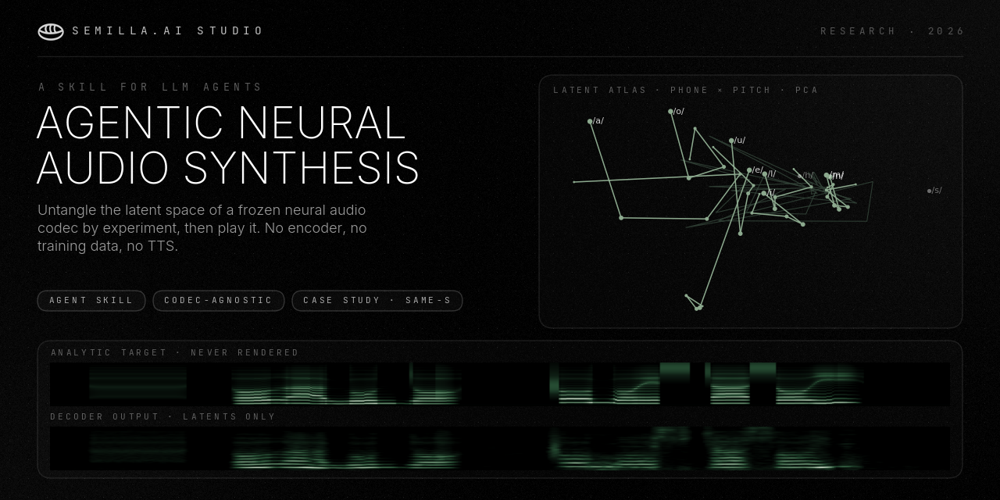

# Agentic Neural Audio Synthesis

**[SEMILLA.AI Studio](https://semilla.ai) · Moisés Horta Valenzuela**

A skill that lets an LLM agent untangle the latent space of a frozen neural audio codec by experiment, then use that
map to produce sounds the user asks for. It needs no encoder, no training data, no TTS and no reference audio. The
agent cannot hear, so it judges every result by measurements and spectrograms.

- **The skill:** [`.claude/skills/agentic-neural-audio-synthesis/SKILL.md`](.claude/skills/agentic-neural-audio-synthesis/SKILL.md). It has eight codec-agnostic phases: reconnaissance, anchor probing, analytic targets, a unit × pitch latent atlas, locality-aware composition, guarded refinement, local latent surgery, and proxy evaluation.
- **The paper (arXiv draft):** [`paper/main.pdf`](paper/main.pdf), *Agentic Neural Audio Synthesis: A Skill for LLM Agents to Disentangle and Play Frozen Neural Audio Codecs*.
- **The case study** that the skill was distilled from, `hello_world_docs/`. An LLM agent mapped the SAME-S decoder (Stable Audio family) and made it say *"hola mundo, cómo estás hoy?"*. It worked in one autonomous session of about 3.9 hours, from a single prompt. The folder is the complete record: 23 numbered iterations, each with its audio, latents, spectrograms and metrics.

What the agent found about the latent space:
- Pitch is not a shared direction; per-phone pitch directions are near-orthogonal (mean |cos| 0.09–0.12).
- Latent frames are exactly local within 6-frame windows.
- The loss landscape needs noise smoothing.
- The decoder games periodicity objectives by repeating one 256-sample patch, which produces a buzz at 44100/256 = 172.27 Hz.

The skill turns each of these into a test to run on any new codec.

The skill has been distilled from one session, on one codec, for one kind of sound. It is general by design but not
yet by experiment. Running it with other agents, other codecs (EnCodec, DAC, RAVE) and other sounds is the open next step.

Case-study results (proxies, re-measured with `paper/stage_metrics.py`):

| | male take | female take |
|---|---|---|
| audio | [`final/hola_mundo_male.wav`](hello_world_docs/final/hola_mundo_male.wav) | [`final/hola_mundo_female.wav`](hello_world_docs/final/hola_mundo_female.wav) |
| harmonics-to-noise ratio (median, vowels) | 17.6 dB | 17.9 dB |
| vowels identified from formants | 100 % | 90 % |
| pitch error vs planned contour | 92 cents | 69 cents |
| log-mel distance to the phonetic plan | 3.84 dB | 3.46 dB |

- Iteration log: [`hello_world_docs/LOG.md`](hello_world_docs/LOG.md)
- Related work and verified references: [`paper/REFERENCES.md`](paper/REFERENCES.md)

## How the skill works (as run in the case study)

| phase | what the agent does | what it learns about the latent space |
|---|---|---|
| P0 reconnaissance | reads the decoder source; measures the receptive field | rate, hop, width, normalisation, temporal locality |
| P1 anchors & probes | decodes zero, random and static latents; finds a silence latent | where silence, noise and tone live; whether the code is distributed |
| P2 target as physics | writes the request as closed-form expected STFT power | a data-free reference |
| P3 unit atlas | one latent per unit, then per unit × pitch | which factors are shared directions and which are entangled |
| P4 composition & search | atlas interpolation, population, frame crossover, latent noise | landscape roughness, frame independence |
| P5 guarded refinement | perceptual losses, then a guard for every cheat found | the decoder's degenerate modes |
| P6 local surgery | re-searches the few frames a short window reproduces exactly | where global optimisation is stuck |
| P7 proxy evaluation | proxies, per-frame audit, rejection rule, numbered log | attractors the plan should not fight |

In the case study:

1. **Read the decoder.** The agent read the TorchScript source to learn the sample rate, latent size, hop, normalisation and receptive field. It then probed the decoder with zero, random and constant latents.
2. **Write the target as physics, not audio.** The sentence becomes phone tables: formants, bandwidths, voicing and noise levels, durations and a Spanish F0 contour. These are turned into the closed-form *expected STFT power* of a source–filter model. The target lives only inside the loss and is never rendered to sound.
3. **Optimise latents through the frozen decoder** with a multi-resolution log-mel loss on STFT **magnitude**. A power loss makes silence an attractor.
4. **Build a vocabulary.** The agent finds one static latent per phone and per pitch level, by gradient descent through the frozen decoder. Sentences start as an interpolation of vocabulary entries. Pitch is not a shared latent direction, so every phone needs its own pitch ladder.
5. **Search robustly.** Optimise a population in one GPU batch, splice the best candidate for each frame (the decoder sees about ±1 frame), and add Gaussian noise to the latents during optimisation (σ 0.05–0.1). Without the noise the optimiser drifts away from good solutions: 4.7 → 9–19 dB at σ = 0, while σ = 0.1 held it.
6. **Make the voice periodic and block the cheats.** A differentiable autocorrelation hinge at the pitch period (r ≥ 0.97) gives a clean voice. Guards stop an octave-up solution and a 172.27 Hz buzz (= 44100/256) that the decoder produces by repeating one 256-sample patch.
7. **Local latent surgery.** A 6-frame window starting on an even frame reproduces the full decode of its 2 middle frames exactly (max error 1e-6). Those 2 frames can be re-searched with 48 restarts and spliced back. This is what fixed the /k/ burst and the silent /t/ closure, which global optimisation never reached.

## Repository layout

```
hello_world_docs/            the experiment (run scripts from inside this folder)
  samesdec.py                load ONLY the decoder, decode, save wav/spectrogram
  phonetics.py               Spanish phone tables, prosody (UTT, UTT2, UTT2_BREATH), analytic expected-STFT target
  optim_core.py              losses: magnitude log-mel, harmonic, periodicity + guards, silence, aperiodicity
  analysis.py                perceptual proxies: LPC vowel ID, pYIN F0, HNR, voicing, sibilants
  00_explore.py              decoder probes, silence latent, per-dimension sweeps
  01_optimize.py             iterations 1-2 (power-mel baseline, curriculum)
  02_phoneme_codebook.py     phone vocabulary
  03_utterance.py            sentence optimiser (population, crossover, latent noise, sweeps, re-pitch, all losses)
  04_pitch_codebook.py       phone x pitch vocabulary
  12_local_surgery.py        local latent surgery
  99_final_report.py         final takes, latent-path analysis, progression montage
  NN_*/                      every iteration: wavs, spectrograms, latents (.npy), metrics (.json)
  final/                     final takes + latents
  LOG.md                     iteration log
paper/                       main.tex, main.pdf, make_figures.py (Fig. 2), stage_metrics.py (Table 2), REFERENCES.md
assets/                      banner.png
neural-audio-codec/          put same-s-cpu.ts here (not included)
(tribal_guarachero_docs/)    in progress, not yet committed: the skill applied to a 32-bar percussion piece
```

## Setup

Python 3.10, plus:

```
pip install torch==2.10.0 numpy==2.2.6 librosa==0.11.0 soundfile==0.13.1 matplotlib==3.10.8 scipy==1.15.3 pillow
```

The decoder is the SAME-S autoencoder (Stable Audio family) as a TorchScript file, `same-s-cpu.ts` (433 MB). It is
not in this repository. Put it at `neural-audio-codec/same-s-cpu.ts`. Only `core.decode()` is ever called; the
encoder is never used.

The run used an Apple M4 Max with `torch.device("mps")` (hard-coded in `optim_core.py`). On CUDA, change `DEV` there.
Use fp32: fp16 gradients were NaN, and bf16 gradients were uncorrelated with fp32.

## Reproduce

### 1. Listen to any stage exactly (decode the saved latents)

```
cd hello_world_docs
python -c "
import numpy as np, torch
from samesdec import load_decoder, decode, save_wav
core = load_decoder('cpu')
z = torch.tensor(np.load('final/latents_female.npy'), dtype=torch.float32)  # or NN_stage/latents.npy
y = decode(core, z)[0].detach().numpy()
save_wav('female.wav', y / abs(y).max() * 0.89)
"
```

For `latents_population.npy`, pick a candidate first, e.g. `np.load(...)[1]`.

### 2. Re-run the whole pipeline

These are the case-study commands, in order, run from `hello_world_docs/`. The scripts were edited in place as the
work went on, so the scripts here are the final versions. Early stages re-run with today's defaults reproduce the
method but not bit-identical takes. MPS is not deterministic either. The saved latents are the ground truth.

```
python 00_explore.py
python 01_optimize.py --tag 01_baseline --steps 600
python 01_optimize.py --tag 02_curriculum_test --steps 300 --batch 8
python 02_phoneme_codebook.py
python 03_utterance.py --tag 03_codebook_init --steps 1200 --pop 8
python 04_pitch_codebook.py
python 03_utterance.py --tag 05_pitchbook_prosody2 --utt UTT2 --init pitchbook --steps 2000 --pop 8 --w_harm 0.5 --room -50
python 03_utterance.py --tag 06_sweep_sigma_harm --utt UTT2 --init 05_pitchbook_prosody2/latents.npy --steps 800 --lr 0.004 --floor0 -70 --room -50 --sweep "0:0.5,0:1.5,0:3,0.05:1.5,0.1:1.5,0.05:3"
python 03_utterance.py --tag 07_repitch --utt UTT2 --init 06_sweep_sigma_harm/latents.npy --repitch --steps 1200 --lr 0.004 --floor0 -70 --room -50 --sweep "0.05:3,0.1:3,0.05:6,0.1:6"
python 03_utterance.py --tag 08_periodicity --utt UTT2 --init 07_repitch/latents.npy --repitch --steps 1000 --lr 0.004 --floor0 -70 --room -50 --sweep "0.1:3:0,0.1:3:1,0.1:3:3,0.1:3:10"
python 03_utterance.py --tag 09_silence_guard --utt UTT2 --init 08_periodicity/latents_population.npy:2 --repitch --pull 0.3 --w_sil 1 --steps 1000 --lr 0.004 --floor0 -70 --room -50 --sweep "0.1:3:1,0.1:3:3,0.07:3:3,0.1:6:3"
python 03_utterance.py --tag 10_guards --utt UTT2 --init 08_periodicity/latents_population.npy:2 --repitch --w_sil 1 --steps 1000 --lr 0.004 --floor0 -70 --room -50 --sweep "0.07:3:2,0.07:3:3,0.1:3:2,0.1:3:3"
python 03_utterance.py --tag 11_bursts --utt UTT2 --init 10_guards/latents_population.npy:1 --repitch --w_sil 1 --w_burst 5 --steps 1000 --lr 0.004 --floor0 -70 --room -50 --sweep "0.07:3:3,0.07:3:2,0.05:3:3,0.1:3:3"
python 12_local_surgery.py --init 11_bursts/latents_population.npy:3 --f0_curve 11_bursts/f0_curve.npy --sites 10,16,18
python 12_local_surgery.py --tag 13_surgery_glide --init 12_local_surgery/latents.npy --f0_curve 11_bursts/f0_curve.npy --sites 20 --B 48 --steps 400
python 12_local_surgery.py --tag 14_surgery_accent --init 13_surgery_glide/latents.npy --f0_curve 12_local_surgery/f0_plan_curve.npy --sites 10,12 --B 48 --steps 400   # rejected branch
python 04_pitch_codebook.py --out 15_pitch_codebook_female --f0s 165,195,230,270,320 --formant_scale 1.15
python 03_utterance.py --tag 16_female_base --utt UTT2_BREATH --init pitchbook --book 15_pitch_codebook_female --f0_scale 1.75 --formant_scale 1.15 --f_ap 5175 --steps 2000 --pop 8 --w_harm 0.5 --room -50 --w_sil 1
python 03_utterance.py --tag 17_female_periodicity --utt UTT2_BREATH --init 16_female_base/latents.npy --repitch --f0_scale 1.75 --formant_scale 1.15 --f_ap 5175 --w_sil 1 --steps 1000 --lr 0.004 --floor0 -70 --room -50 --sweep "0.07:3:3,0.1:3:3,0.07:3:2,0.05:3:3"
python 12_local_surgery.py --tag 18_female_surgery --init 17_female_periodicity/latents_population.npy:1 --f0_curve 17_female_periodicity/f0_curve.npy --utt UTT2_BREATH --formant_scale 1.15 --f_ap 5175 --sites 8,14,18,20,22 --steps 400
python 12_local_surgery.py --tag 19_female_surgery_d --init 18_female_surgery/latents.npy --f0_curve 17_female_periodicity/f0_curve.npy --utt UTT2_BREATH --formant_scale 1.15 --f_ap 5175 --sites 8 --win 8 --free 3,4 --steps 400
python 03_utterance.py --tag 20_female_polish --utt UTT2_BREATH --init 19_female_surgery_d/latents.npy --repitch --f0_scale 1.75 --formant_scale 1.15 --f_ap 5175 --w_sil 1 --w_aper 1 --w_burst 3 --steps 600 --lr 0.002 --floor0 -70 --room -50 --sweep "0.1:3:3,0.07:3:3,0.1:3:2"
python 03_utterance.py --tag 21_male_polish --utt UTT2 --init 13_surgery_glide/latents.npy --repitch --w_sil 1 --w_aper 1 --w_burst 3 --steps 600 --lr 0.002 --floor0 -70 --room -50 --sweep "0.1:3:3,0.07:3:3,0.1:3:2"
python 99_final_report.py --takes "male=21_male_polish/latents_population.npy:0=UTT2=04_pitch_codebook=1.0=1.0" "female=20_female_polish/latents_population.npy:1=UTT2_BREATH=15_pitch_codebook_female=1.75=1.15" --progression 01_baseline/latents.npy 02_curriculum_test/latents.npy 03_codebook_init/latents.npy 05_pitchbook_prosody2/latents.npy 08_periodicity/latents_population.npy:2 10_guards/latents_population.npy:1 13_surgery_glide/latents.npy 21_male_polish/latents_population.npy:0 16_female_base/latents.npy 20_female_polish/latents_population.npy:1
```

`12_local_surgery.py --tag 14_surgery_accent` needs `12_local_surgery/f0_plan_curve.npy`. The agent wrote that file with:
`python -c "import numpy as np; from phonetics import tracks, UTT2; t = np.arange(0, 2.7, 256/44100); np.save('12_local_surgery/f0_plan_curve.npy', np.stack([t, tracks(t, utt=UTT2, jitter=0)['f0']]))"`

`--sweep "sigma:w_harm:w_per,..."` runs one A/B candidate per entry in the same GPU batch. In a sweep,
`hola_mundo.wav` is the lowest-loss candidate, not always the one carried forward. The next command's `--init ...:N`
shows which candidate was kept.

Runtime on the M4 Max: about 265 ms per step for 8 candidates × 2.6 s of audio. Keep a batch under about 300 latent
frames per step; larger batches pushed unified memory into swap and ran about 10× slower.

### 3. Paper figures, table and PDF

```
python paper/stage_metrics.py           # re-measures every carried-forward take -> paper/stage_metrics.json (Table 2)
python paper/make_figures.py            # schematic + pitch-direction diagnostic -> paper/fig_schematic.pdf (Fig. 2)
cd paper && pdflatex main.tex && pdflatex main.tex
```

## Use the skill on your own codec and sound

[`.claude/skills/agentic-neural-audio-synthesis/SKILL.md`](.claude/skills/agentic-neural-audio-synthesis/SKILL.md)
turns this run into a playbook for an agent. With any coding agent that loads Agent Skills, open this repository and ask for a sound, for example
*"use only the decoder in neural-audio-codec/ to make a sustained cello note"*. The skill loads automatically. To
use it in other projects, copy the folder into your agent's skills directory (for Claude Code: `~/.claude/skills/`).

The original prompt, verbatim (the last line means "do not use any TTS or other audio sources"):

> You have only one task, which comprises of using ONLY the decoder from the same-s-cpu.ts neural audio codec in the
> neural-audio-codec folder to produce the words 'hola mundo, cómo estás hoy?' using only basic python, librosa, numpy
> and torch (find a conda env that already has these installed) to create latents for the same-s-cpu decoder, and
> then you should analize the resulting audio percetually in order to create as realistic as possible voice that
> produces those words. You can iterate on your generations but you need to save your progress (audio .wavs and
> spectrograms and latent analysis files) in the hello_world_docs folder that you create. Be creative
> ### HARD GUIDELINES You can only generate audio using the same-s decoder using latents that you create with python numpy and torch
> ### HARD RESTRICTIONS - use any TTS or other audio files sources

## Limitations

- One sentence, one decoder, two voices.
- No human listening test or ASR intelligibility score yet. Every number above is a signal-level proxy.
- The quality ceiling comes from the hand-written phonetic target and from the decoder's training prior.
- Known artefacts: the male "cómo" is flatter in pitch than planned, the /d/ in "mundo" is weak, and the short female /e/ drifts toward /o/.

## Credits and license

[SEMILLA.AI Studio](https://semilla.ai) · Moisés Horta Valenzuela.

Licensed under [Creative Commons Attribution-NonCommercial 4.0 International (CC BY-NC 4.0)](https://creativecommons.org/licenses/by-nc/4.0/); see [`LICENSE`](LICENSE). You may copy, share, change and remix this work, with attribution, for non-commercial purposes. The SAME-S decoder is not part of this repository and keeps its own license.
